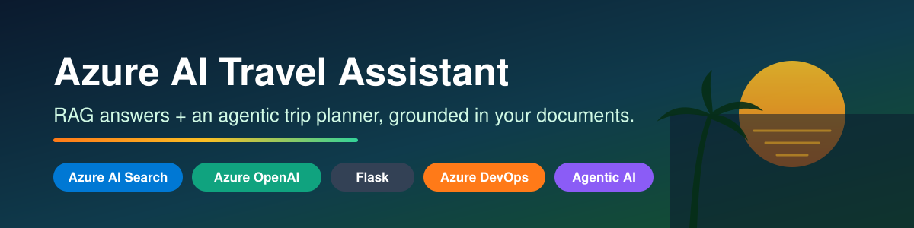
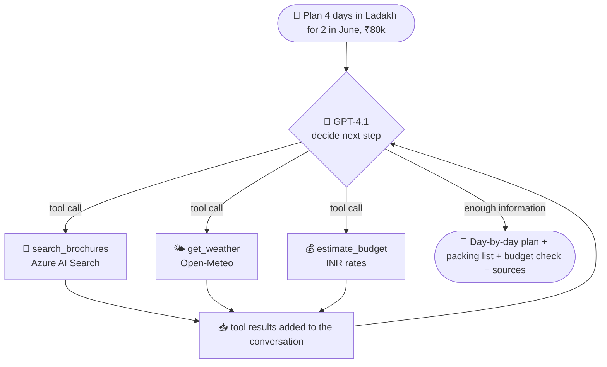
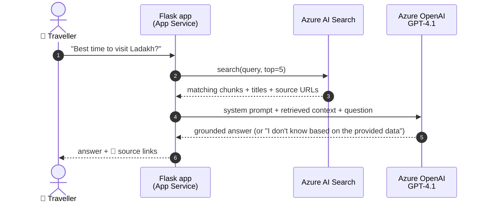
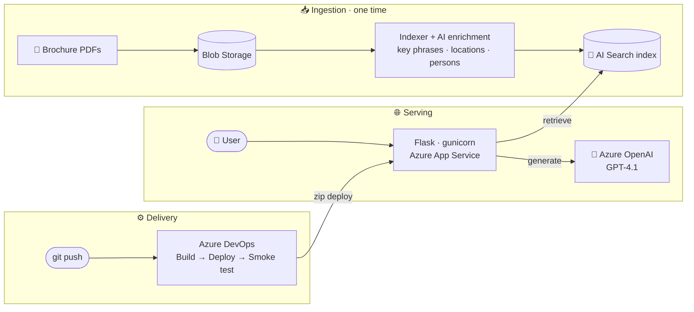
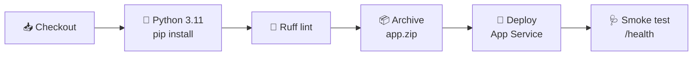

<p align="center">
  
</p>

<p align="center">
  <a href="https://github.com/N-Subramanya/azure-agentic-travel-planner/actions/workflows/ci.yml"></a>
  
  
  
  
  
  
  
  
</p>

<p align="center">
  <b>RAG + an agentic AI trip planner on Azure, built end to end.</b><br>
  Documents are indexed by Azure AI Search. A GPT-4.1 agent decides when to search them, check live weather and estimate budgets.
  The app is served by Flask on App Service and shipped by an Azure DevOps YAML pipeline.
</p>

---

## 🚀 Overview

**Konaseema Travels** is a demo travel brand. Customers ask natural-language questions such as
*"What's the best time to visit the Kerala backwaters?"* and get answers **grounded only in the company's own brochures**, with links to the sources.

<p align="center">
  
</p>

The app has three modes:

| Mode | Route | What it does |
|---|---|---|
| 🔎 **Smart search** | `app.py` → `/search` | Keyword search over AI-enriched documents, showing key phrases, locations and people |
| 💬 **RAG Q&A** | `rag_app.py` → `/ask` | Fixed pipeline: retrieve the top chunks, then GPT-4.1 answers with citations |
| 🤖 **AI Trip Planner** | `rag_app.py` → `/agent` | **Agentic**: GPT-4.1 decides which tools to call, in a loop, then plans the trip, with chat memory for follow-ups |

## 🤖 Agent Mode: RAG vs Agentic

|  | 💬 RAG Q&A | 🤖 AI Trip Planner |
|---|---|---|
| Who decides the steps? | The code: always search once, then answer | **The model**: it chooses tools and their arguments |
| Tools | Search only | Search, live weather and budget estimate |
| Steps per question | 1 retrieval + 1 LLM call | Loop of up to 6 steps, with parallel tool calls |
| Follow-ups | ❌ | ✅ Remembers the conversation ("make it 3 days instead") |
| Transparency | Sources | Sources **plus a trace of every tool call** |



| Tool | Purpose | Backed by |
|---|---|---|
| `search_brochures(query)` | Destination facts, attractions, packages and prices | Azure AI Search index |
| `get_weather(city, country_code, month?)` | Live 7-day forecast, or travel-month averages | [Open-Meteo](https://open-meteo.com) (free, no key) |
| `estimate_budget(destination, days, travellers, style)` | Rough trip cost: stay, food, transport, activities | Built-in INR rate table |

**Guardrails:** a 6-step limit, after which the model is forced to answer without calling more tools. Destination facts are grounded in brochure results only. A failed tool returns an error the model can recover from. Errors are logged on the server and never shown to users.

## 🧠 How RAG Works Here



Answers stay **grounded**: the prompt tells the model to use only the retrieved context and to say so when the answer isn't in it. This reduces hallucinations.

## 🏗️ Architecture



## ✨ Features

| | Feature | Details |
|---|---|---|
| 🤖 | **Agentic trip planner** | GPT-4.1 tool calling: search, weather and budget tools in a reasoning loop, with a visible step trace |
| 🧠 | **Conversation memory** | Follow-up questions keep their context, stored in a size-capped, signed session cookie |
| 🔎 | **AI-enriched search** | Blob indexer with cognitive skills that extract key phrases, locations and persons |
| 💬 | **Grounded answers** | Context-only prompting, citations and low temperature (0.3) |
| 📎 | **Source citations** | Every answer links back to the brochure it came from |
| ⚙️ | **YAML CI/CD** | Multi-stage Azure DevOps pipeline: lint → package → deploy → `/health` smoke test |
| 🔐 | **No secrets in code** | `.env` locally; locked variable group and App Service settings in the cloud |
| 🩺 | **Health endpoint** | `/health` for pipeline smoke tests and uptime probes |
| 🛡️ | **Safe error handling** | Users see a friendly message, and the full exception goes to the logs |

## ⚙️ CI/CD Pipeline



| Stage | Steps |
|---|---|
| **Build** | Install dependencies, lint, copy only app files, zip them, publish the `drop` artifact |
| **Deploy** | `production` environment (optional approval gate), then `AzureWebApp@1` zip deploy with the Oryx build, startup command and app settings from the variable group |
| **Verify** | Polls `https://<app>.azurewebsites.net/health` until the app responds |

The full pipeline is in [`azure-pipelines.yml`](azure-pipelines.yml).

## 🧰 Tech Stack

| Layer | Technology |
|---|---|
| Retrieval | Azure AI Search (blob indexer, cognitive skills) |
| Generation | Azure OpenAI GPT-4.1 (`openai` Python SDK) |
| Web | Python 3.11 · Flask · Jinja2 · gunicorn |
| Hosting | Azure App Service (Linux) |
| Storage | Azure Blob Storage |
| CI/CD | Azure DevOps YAML pipelines · GitHub Actions (lint) |

## 📂 Project Structure

```text
azure-agentic-travel-planner/
├── rag_app.py              # 💬 RAG Q&A + 🤖 agent routes (/ask, /agent, /health)
├── agent.py                # 🤖 tool definitions + agent loop
├── app.py                  # 🔎 keyword search app
├── templates/              # Jinja2 pages (home, results, agent chat, search, error)
├── static/                 # CSS + images
├── data/collateral/        # sample travel brochures to index
├── azure-pipelines.yml     # ADO multi-stage pipeline
├── .github/workflows/      # GitHub Actions lint → CI badge
├── docs/azure-setup.md     # step-by-step Azure + ADO setup
├── .env.example            # config template (copy to .env)
└── requirements.txt
```

## ⚡ Quick Start

**1. Set up Azure.** Create Blob Storage, AI Search (index `data/collateral`) and an Azure OpenAI deployment. See the [setup guide](docs/azure-setup.md).

**2. Run locally**
```bash
git clone https://github.com/N-Subramanya/azure-agentic-travel-planner.git
cd azure-agentic-travel-planner

python -m venv .venv
source .venv/bin/activate        # Windows: .venv\Scripts\activate
pip install -r requirements.txt

cp .env.example .env             # then fill in your endpoints and keys
python rag_app.py                # → http://127.0.0.1:5000  (agent: /agent)
```

**3. Deploy.** Create the ADO service connection, the `rag-app-settings` variable group and the `production` environment, then run `azure-pipelines.yml`.

## 🔐 Security

- `.env` is git-ignored. Only `.env.example`, with placeholders, is committed.
- Keys live in a **locked** ADO variable group and are injected into App Service settings at deploy time.
- The service connection uses **workload identity federation**, so no client secret is stored.
- Errors are logged on the server and never shown to users.

## 🗺️ Roadmap

- [x] RAG Q&A with citations on Azure AI Search and Azure OpenAI
- [x] YAML multi-stage Azure DevOps pipeline with a smoke test
- [x] Agentic trip planner: tool calling for search, weather and budget, with a step trace
- [x] Chat history and follow-up questions
- [ ] Managed Identity and Key Vault references (remove API keys entirely)
- [ ] Infrastructure as code (Terraform/Bicep) for all Azure resources
- [ ] Hybrid and vector search with semantic ranking
- [ ] More tools: currency conversion, live hotel availability, booking hand-off
- [ ] Application Insights telemetry and token/cost tracking per agent run

## 📄 License

[MIT](LICENSE) © Subramanya N
